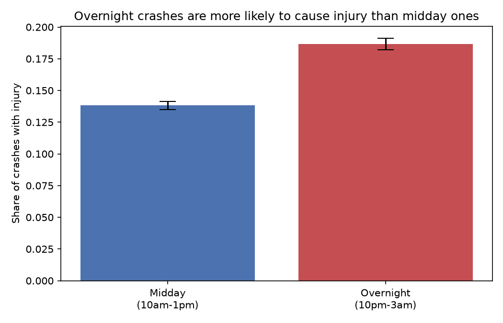
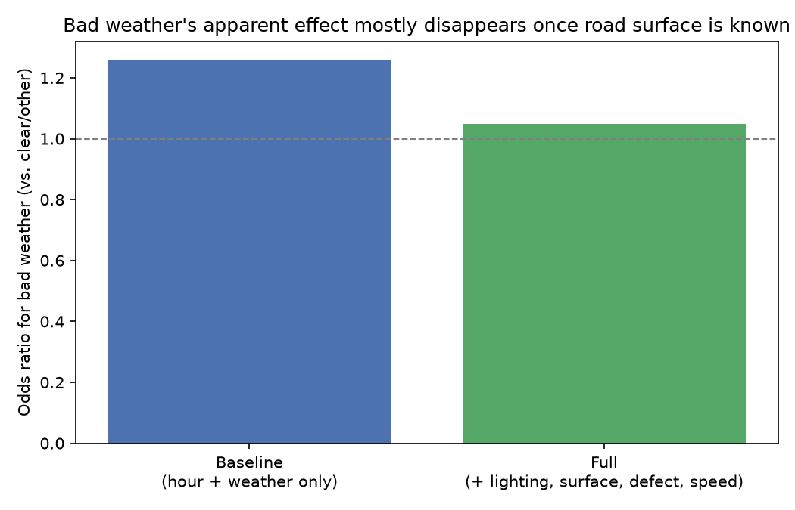
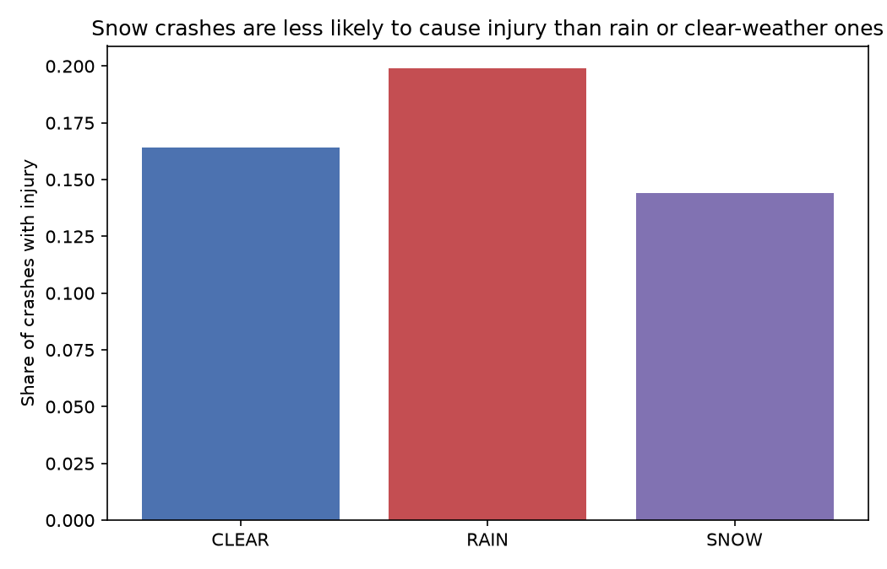

# Chicago Traffic Crash Analytics

CS 418 Group Project

## Main Findings (Narrative Analysis)

- Overnight crashes (10pm-3am) are way more likely to result in injury than
  midday crashes (10am-1pm), about an 18.7% vs 13.8% injury rate.
- Weather looking "dangerous" (rain, snow, fog, etc.) barely matters once
  you already know the road surface condition, it's basically the same
  signal twice, not two separate risk factors.
- Snow crashes have a *lower* injury rate than clear-weather crashes, which
  is backwards from what we expected going in.

### Finding 1: overnight crashes are riskier than midday ones

We split crashes into two time windows, overnight (10pm-3am, n=28,925) and
midday (10am-1pm, n=46,449), and looked at what share of each resulted in
at least one injury. Midday sits at 13.8% (95% CI 13.5%-14.1%), overnight
jumps to 18.7% (95% CI 18.2%-19.1%). That's a 4.9 percentage point gap and
the confidence intervals don't even come close to overlapping, a two
proportion z-test gives p = 6e-71, so this is not noise. We checked if this
was just a volume thing (fewer cars overnight = more room to speed) and it
lines up with that story, though we can't fully prove speed is the reason
since we don't have actual vehicle speed at time of crash, only the posted
limit. Either way: when a crash does happen overnight, it's meaningfully
more likely to hurt someone than one that happens at midday.



### Finding 2: the "weather effect" mostly disappears once you control for road surface

This is the one that surprised us. Going in, we expected rain/snow/fog to
independently raise injury risk even after controlling for other stuff. We
ran two logistic regressions: a baseline with just hour-of-day and a
bad-weather flag, and a full model that adds lighting, road surface
condition, road defect, and posted speed limit. In the baseline, bad
weather pushes injury odds up by a factor of 1.26 (p = 2e-40), seems
real. But in the full model, that drops to basically nothing, 1.05x,
p = 0.12, not significant anymore. We dug into why and it's pretty simple:
weather and road surface are basically measuring the same thing twice.
83% of "bad weather" crashes happen on a wet/snowy/icy surface, vs only
3.6% of "clear/other" weather crashes. So once the model already knows the
road is wet, it doesn't learn much new from also being told it's raining.
This isn't really a null result so much as "weather's effect runs through
road surface, not around it."



### Finding 3: snow crashes are somehow safer than clear-weather ones

Clear weather has a 16.4% injury rate (CI 16.2%-16.6%), rain is worse at
19.9% (CI 19.3%-20.5%), but snow comes in lower than both at 14.4% (CI
13.4%-15.5%). A direct snow vs clear z-test gives p = 0.0005, so this
isn't just random variation, snow really is lower. We tried to break this
by checking if posted speed limit explains it (maybe snow crashes just
happen on lower-speed streets), but average speed limit is basically
identical across clear/rain/snow (all ~28.5-29 mph), so that's not it. Our
best guess, which we can't fully confirm with this data, is that people
visibly drive more cautiously when it's actively snowing than when
roads are merely wet from rain, since snow is more obviously dangerous
looking out the windshield. This one's still an open question for us,
we'd want road-surface-specific speed data or a before/after snowstorm
comparison to actually confirm it.



### Analyses we tried and didn't use

- We looked at lighting condition on its own (darkness vs daylight) but it
  tracks crash hour so closely that it didn't add a separate story beyond
  Finding 1, would've just been repeating ourselves.
- We tried joining the Traffic Tracker Congestion data into the injury
  model directly, but we only have one day of congestion data pulled so
  far (see `EDA.md` relationship 4), not enough to put a real number on it
  for this checkpoint. Flagged as a next step.
- We checked crash_day_of_week as a predictor but the differences between
  days were small and not worth a whole finding on their own.

Full notebook behind these numbers: [`notebooks/narrative.ipynb`](notebooks/narrative.ipynb)
(builds on `eda.ipynb`). Longer notes on checks we ran: [`NARRATIVE.md`](NARRATIVE.md).

## Team

- Anirudh Kuppili (anirudhk_tech)
- Karim Nashawi (KarimNashawi)
- Kareem Muftee (k-mufti)
- Arslan Kamchybekov (ArslanKamchybekov)
- Nguyen Tuan Kiet Ho (kiet08hogit)

## Research Question

What factors predict whether a Chicago traffic crash results in injury, and do
time-of-day and weather effects persist after controlling for road and crash
characteristics (e.g. road surface, lighting condition, posted speed limit,
crash type)?

## Datasets

### Primary

1. **[Traffic Crashes - Crashes](https://data.cityofchicago.org/Transportation/Traffic-Crashes-Crashes/85ca-t3if)**
   (City of Chicago Data Portal). Crash-level records since September 2017,
   including injury outcome, weather condition, lighting condition, road
   surface condition, posted speed limit, and crash time/date. This is the
   core table for the injury-prediction model.
2. **[Traffic Crashes - People](https://data.cityofchicago.org/Transportation/Traffic-Crashes-People/u6pd-qa9d)**
   (City of Chicago Data Portal). Person-level records for everyone involved
   in a crash, with a finer-grained injury classification per person plus
   demographics (age, sex) and safety equipment used. Lets us build a more
   precise injury target and check whether person-level factors matter
   alongside crash-level ones.

### Secondary

1. **NOAA daily weather data (GHCND)** (Midway station, via NOAA Climate
   Data Online). We'd join this to crash dates to cross-check the crash
   report's self-reported weather field against actual recorded conditions
   (precipitation, snow, temperature) on the day of the crash.
2. **[Chicago Traffic Tracker - Historical Congestion Estimates by Segment](https://data.cityofchicago.org/Transportation/Chicago-Traffic-Tracker-Historical-Congestion-Esti/4g9f-3jbs)**
   (City of Chicago Data Portal). Speed/congestion estimates by road segment.
   We'd compare this against crash locations/times to see whether traffic
   volume or congestion level is a confounder for the road-characteristic
   controls in the model.

## Data Acquisition

See `notebooks/data_acquisition.ipynb` for the full pull (column types, head
of each dataframe, etc.). Basic shape and coverage, from actually running the
notebook:

| Dataset | Rows | Columns | Time span pulled | Geography |
|---|---|---|---|---|
| Traffic Crashes - Crashes | 222,811 | 49 | 2023-01-01 to 2024-12-31 (full window, paginated) | Chicago |
| Traffic Crashes - People | 491,892 | 29 | 2023-01-01 to 2024-12-31 (full window, paginated) | Chicago |
| NOAA daily weather (GHCND) | 317 | 5 | 2023-01-01 to 2023-01-31 | Midway station (GHCND:USW00014819) |
| Traffic Tracker Congestion | 50,000 | 22 | 2024-06-11 (single day) | Chicago arterial segments |

One row in Traffic Crashes - Crashes represents a single crash event. One row
in Traffic Crashes - People represents one person involved in a crash (so
multiple rows per crash, ~2.2 people per crash on average). The crashes and
people tables are now pulled in full for the 2023-2024 window via pagination
(`scripts/fetch_full_data.py`) rather than the 50,000-row sample from the
Checkpoint 2 pull, which undercounted ~78% of crashes and ~90% of people in
that window. Columns we care most about in Crashes: `injuries_total`,
`most_severe_injury`, `weather_condition`, `lighting_condition`,
`roadway_surface_cond`, `road_defect`, `posted_speed_limit`, `crash_hour`,
`crash_day_of_week`, `first_crash_type`.

## Exploratory Analysis

Full writeup: [`EDA.md`](EDA.md). Notebook: [`notebooks/eda.ipynb`](notebooks/eda.ipynb).

**Dataset basics:** Traffic Crashes - Crashes is 222,811 rows × 49 columns
(one row per crash); Traffic Crashes - People is 491,892 rows × 29 columns
(one row per person involved in a crash). All API columns come back as
strings and need `pd.to_numeric()` before numeric analysis.

**Revised research question:** What factors predict whether a Chicago
traffic crash results in injury, and do time-of-day, lighting, and weather
effects persist after controlling for road characteristics (surface,
defect, speed limit, crash type) and, if available, traffic
volume/congestion? (Added lighting and congestion explicitly, and class
imbalance as a modeling consideration, see `EDA.md` section 5 for why.)

**Anomalies found:**

| Anomaly | Rows affected | What we did |
|---|---|---|
| All columns typed as `str`, including numeric fields | All rows | Cast with `pd.to_numeric(errors="coerce")` |
| Invalid posted speed limit (0 or >70 mph) | 364 crash rows | Excluded from distribution plot; will exclude/cap for modeling |
| `"UNKNOWN"` as a non-null placeholder (weather/lighting/surface/road-defect) | 6.7-25.7% of rows depending on field | Kept as explicit category, treated as missing-not-at-random |
| Invalid ages (negative or >100) | 24 people rows | Will drop for age-based analysis |
| Missing age | 143,700 people rows (~29%) | Left null, not central to crash-level model |
| Duplicate crash records | 0 | Checked, none found |

**Significant findings:** Injury rate is a minority outcome overall (15.8%)
but varies meaningfully by hour (~13% midday vs. ~19-20% overnight), weather
(up to 25% in severe conditions vs. 16.4% in clear weather, with a
surprising exception where snow alone is *below* average), and lighting
(19.8% for lit darkness vs. 15.4% for daylight). These three factors look
correlated with each other, which motivates the planned baseline-vs-full
model comparison to see which effects are independent. A first pass joining
the Traffic Tracker Congestion dataset also hints that traffic
speed/volume may be a relevant additional control.

## Data Documentation

Full datasheet, scope, codebook, recipe, FAIR info, and people/CARE
considerations: [`DATASHEET.md`](DATASHEET.md).

| Dataset | Source | License |
|---|---|---|
| Traffic Crashes - Crashes | [City of Chicago Data Portal](https://data.cityofchicago.org/Transportation/Traffic-Crashes-Crashes/85ca-t3if) | Chicago Data Portal terms of use (free public reuse) |
| Traffic Crashes - People | [City of Chicago Data Portal](https://data.cityofchicago.org/Transportation/Traffic-Crashes-People/u6pd-qa9d) | Chicago Data Portal terms of use (free public reuse) |
| Chicago Traffic Tracker Congestion (secondary) | [City of Chicago Data Portal](https://data.cityofchicago.org/Transportation/Chicago-Traffic-Tracker-Historical-Congestion-Esti/4g9f-3jbs) | Chicago Data Portal terms of use (free public reuse) |

**Biggest limitation:** this data only covers crashes that actually get
reported to CPD and entered into E-Crash, not every crash that happens in
Chicago. Minor, no-injury crashes are probably underreported relative to
injury crashes, which could bias our injury rate estimates upward and
means our conclusions apply to "reported crashes," not "all crashes."

## Setup

```
pip install -r requirements.txt
```
